<h1 align="center">
   Prompt
</h1>

  Claude Code 세션 여러 개를 프로젝트별로 묶어 한 창에서 돌리는 맥용 터미널입니다. 
  <a href="https://runners.im/prompt">runners.im/prompt</a>

  <a href="../../README.md">English</a> · 한국어

<!-- runners.im/prompt 의 화면 캡처가 들어갈 자리 -->

## 먼저 알아 둘 말

- **Claude Code**: 터미널에서 실행하는 Anthropic 의 AI 코딩 도구입니다. Prompt 는 이 도구를 여러 개 동시에 띄워 두고 관리하려고 만든 앱입니다.
- **세션**: Claude Code 를 한 번 실행해서 대화를 이어 가는 단위입니다. Prompt 에서는 세션 하나가 탭 하나에 들어 있습니다.
- **프로젝트**: Prompt 에 추가한 코드 폴더(git 저장소)입니다. 세션은 프로젝트 아래에 묶여서 보입니다.
- **상태 막대**: Prompt 창 맨 아래에 있는 가는 줄입니다. 사용량 같은 정보를 늘 보이게 하려고 있습니다.
- **메뉴 막대**: 맥 화면 맨 위의 줄입니다. 시계와 와이파이 아이콘이 있는 곳이고, Prompt 도 여기에 아이콘을 하나 둡니다.
- **CLI**: 마우스 대신 터미널에 명령어를 쳐서 앱을 다루는 방법입니다. 스크립트나 AI 가 앱을 직접 조작할 수 있게 하려고 있습니다.

## 1. 설치

Prompt 는 [GitHub Releases](https://github.com/RUNNERS-IM/prompt/releases/latest) 에 올라갑니다. GitHub Releases 는 GitHub 저장소에 설치 파일을 버전별로 올려 두는 곳입니다.

**맥 (Apple silicon, M1 이후 칩):**
[`prompt-macos-arm64.dmg`](https://github.com/RUNNERS-IM/prompt/releases/latest/download/prompt-macos-arm64.dmg)
를 받아 열고, Prompt 를 응용 프로그램 폴더로 끌어다 놓으면 됩니다. 맥 판은 Apple 개발자 인증서로 서명하고 Apple 의 공증(Apple 이 악성 코드가 없는지 검사하고 확인해 주는 절차)까지 받았기 때문에, 처음 열 때 보안 경고가 뜨지 않습니다.

같은 페이지에 다른 운영체제용 파일도 있습니다.

- **Windows (x64):** `prompt-windows-setup.exe`. 아직 코드 서명이 없어서, 처음 설치할 때 Windows 의 SmartScreen(모르는 프로그램을 실행하기 전에 경고하는 기능)이 경고를 띄웁니다. "추가 정보"를 누른 뒤 "실행"을 누르면 됩니다.
- **Linux (x64):** `prompt-linux.AppImage`, 그리고 `.deb` · `.rpm` 꾸러미.

인텔 칩 맥용 파일은 지금은 없습니다.

**업데이트:** Prompt 는 같은 GitHub Releases 에서 새 버전을 확인하고, 있으면 설치할지 물어봅니다. 메뉴 막대 아이콘이나 앱 메뉴의 "업데이트 확인"으로 직접 확인할 수도 있습니다.

## 2. 할 수 있는 일

1. **사이드바에서 세션을 프로젝트별로 봅니다.** 사이드바는 두 단계입니다. 프로젝트마다 한 줄이 있고, 그 아래에 세션이 한 줄씩 붙습니다. 세션 줄에는 이름, 마지막으로 움직인 시간, 지금 하고 있는 일, 상태 아이콘(일하는 중 · 내 답을 기다리는 중 · 끝남 · 실패)이 나옵니다. 어느 세션이 나를 기다리는지 한눈에 찾으려고 있는 기능입니다.
2. **사이드바에서 세션을 다룹니다.** 세션 줄을 오른쪽 클릭하면 이름 바꾸기, 탭 색 정하기, 복사해서 새 창에서 열기, 닫기를 할 수 있습니다. 프로젝트 줄에는 새 세션을 여는 메뉴가 있습니다.
3. **세션마다 Claude 모델을 고릅니다.** 세션마다 모델 메뉴가 있고, 모델을 고르면 Prompt 가 그 세션에 `/model` 명령을 대신 입력합니다. 기본 모델이 아닐 때만 탭과 사이드바에 모델 이름이 보입니다.
4. **창을 여러 개 씁니다.** 새 창을 열고, 탭을 다른 창이나 새 창으로 옮기고, 프로젝트를 따로 창으로 열 수 있습니다. 설정의 "열어 둔 창 기억하기"를 켜 두면, 다음에 Prompt 를 켤 때 창과 탭, 창 크기와 위치가 그대로 다시 열립니다.
5. **Claude 계정을 바꾸고 사용량을 봅니다.** 상태 막대에 Claude 사용량이 나오고, 거기서 Claude 계정을 바꿀 수 있습니다. 계정은 설정에서 추가합니다.
6. **메뉴 막대에서 Claude 가 일하는 중인지 봅니다.** 메뉴 막대의 `>_` 아이콘은 에이전트(Claude 처럼 스스로 작업을 이어 가는 AI 프로그램)가 일하는 동안 커서가 깜박이고, 모두 쉬고 있으면 멈춰 있습니다.
7. **터미널을 나눕니다.** 탭 하나 안에서 터미널을 여러 칸으로 나눠 나란히 볼 수 있습니다.
8. **맥 기본 앱과 같은 모양으로 씁니다.** 시스템 글꼴과 맥에서 고른 강조색을 쓰고, 맥의 라이트 · 다크 모드를 따라갑니다. 터미널은 기본으로 "Prompt Dark" 색 구성을 씁니다.
9. **한국어로 씁니다.** 화면을 한국어와 다른 여러 언어로 볼 수 있습니다. 원래 Orca 에서 번역이 빠져 있던 한국어 문구도 채워 두었습니다.

## 3. CLI

Prompt 에는 명령줄 도구가 들어 있습니다. **명령 이름은 아직 `orca`** (Orca 에서 쓰던 이름)이고, 지금 새로 설계하는 중이라 명령 이름은 앞으로 바뀔 수 있습니다.

- Prompt 안에서 연 터미널에서는 따로 설정하지 않아도 `orca` 를 쓸 수 있습니다.
- 다른 터미널 앱에서도 쓰려면 설정 > 일반 의 CLI 항목에서 켭니다. 맥에서는 `/usr/local/bin` 에 `orca` 가 등록됩니다.
- `orca --help` 를 치면 전체 명령 목록이 나옵니다. 지금 있는 명령 예: `orca status`, `orca worktree list`, `orca terminal list`.

## 4. Orca 와 다른 점

Prompt 는 [Orca](https://github.com/stablyai/orca) 를 바탕으로 만들었습니다. Orca 는 Stably AI 가 MIT 라이선스로 공개한 AI 코딩 도구용 데스크톱 앱입니다. 터미널, 워크트리(git 저장소 하나에서 브랜치마다 작업 폴더를 따로 만드는 기능), 편집기 같은 바탕은 Orca 의 것을 쓰고, Orca 의 새 코드(업스트림)를 주기적으로 합쳐 옵니다. Prompt 에서 바뀐 점은 아래와 같습니다.

- **이름과 앱 정보:** 앱 이름은 Prompt, 번들 ID(맥이 앱을 구별하는 고유 이름)는 `im.runners.prompt`, 앱을 여는 링크는 `prompt://` 로 시작합니다.
- **Orca 서버를 쓰지 않음:** Prompt 는 Orca 회사의 서버와 통신하지 않습니다. Orca 로그인, 중계, 푸시 알림, 플러그인 목록, 업데이트 확인이 모두 꺼져 있고, 텔레메트리(앱 사용 기록을 개발사로 보내는 기능)도 보내지 않습니다.
- **데이터 폴더를 따로 씀:** 설정과 세션은 `Prompt` 폴더에 저장됩니다. 처음 켤 때 기존 Orca 폴더가 있으면 그 내용을 `Prompt` 폴더로 복사합니다. Orca 폴더는 읽기만 하고 고치지 않습니다.
- **Claude 중심 화면:** 위에 적은 두 단계 사이드바, 세션별 모델 메뉴, 여러 창, 메뉴 막대 아이콘은 Prompt 에서 더한 것입니다. Claude 가 아닌 다른 AI 의 사용량 표시는 숨겼습니다.
- **설정 화면을 줄임:** Orca 에서만 쓰는 기능(오케스트레이션, 컴퓨터 사용, 음성, Orca 계정, 모바일, 플러그인, 자동화, 작업 등)의 설정 화면은 숨겼습니다.
- **처음 실행 안내를 줄임:** 처음 쓰는 프로필에서만 나오고, 테마 · 알림 · Yolo 모드(Claude 가 매번 허락을 묻지 않고 바로 실행하게 하는 설정)만 고릅니다.
- **업데이트와 문의:** 업데이트 파일은 [RUNNERS-IM/prompt](https://github.com/RUNNERS-IM/prompt) 에서 받고, 문제 신고도 이 저장소로 갑니다.

Orca 의 원래 README 는 [docs/upstream/README.orca.md](../upstream/README.orca.md) 에 남겨 두었습니다.

## 5. 만든 곳 · 라이선스

Prompt 는 RUNNERS(Runners Co., Ltd.)가 만듭니다.

Copyright (c) 2026 Runners Co., Ltd. All rights reserved. 자세한 내용은 [LICENSE](../../LICENSE) 를 보세요.

Prompt 는 Stably AI 의 Orca 를 바탕으로 했고, Orca 는 MIT 라이선스(Copyright (c) 2026 Lovecast Inc.)로 배포됩니다. Orca 의 저작권 표시와 허가 문구 전문, 그리고 다른 외부 구성 요소의 고지는 [THIRD_PARTY_NOTICES.md](../../THIRD_PARTY_NOTICES.md) 에 있습니다.
